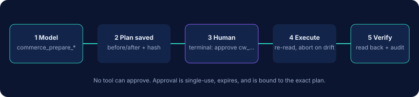

<p align="center"></p>

<p align="center">
  <a href="https://github.com/mysterekkk/commerceweave-mcp/actions/workflows/ci.yml"></a>
  <a href="https://www.npmjs.com/package/commerceweave-mcp"></a>
  <a href="LICENSE"></a>
  
  
  <a href="https://github.com/mysterekkk/commerceweave-mcp/releases"></a>
  <a href="README.pl.md">Polski</a>
</p>

# CommerceWeave MCP

**One MCP server. Three commerce platforms.**

Connect AI agents to **Allegro**, **Base.com** and **WooCommerce** through one secure, self-hosted [MCP](https://modelcontextprotocol.io) server. It runs on your machine over stdio (an authenticated HTTP mode is optional): no VPS, no database, no SaaS account.

> Status: **v0.1.0, validated against local servers that implement each platform's documented protocol, not yet against live accounts.** See [what is and is not tested](docs/api-compatibility.md#live-testing-status).

## Why

[Model Context Protocol](https://modelcontextprotocol.io) lets an AI client (Claude Code, Claude Desktop, Cursor, …) call tools you provide. Most commerce connectors cover **one** platform, expose its API as-is, and let the model write straight away.

CommerceWeave is different in four ways:

1. **One interface.** The same `commerce_*` tools answer questions across Allegro, Base.com and WooCommerce with normalized products and orders that keep every platform id.
2. **Honest answers.** Imported orders are de-duplicated (Allegro order imported into Base is not counted twice), currencies are never mixed, revenue is never called profit, and every result says if it is incomplete.
3. **Read-only by default.** Writes are *proposals* with before/after, bound to an exact plan, and only run after **you** approve in a terminal. The model cannot approve itself.
4. **Local.** `npx` it from your MCP client. Credentials stay on your machine.

It does not replace the official integrations. WooCommerce ships its own MCP integration (developer preview), and several single-platform Allegro and Base.com MCP servers cover far more API methods than this one. See [the landscape](docs/competition.md).

## What works

| Platform | Products | Orders | Stock | Prices | Writes (via approved proposals) |
|---|---|---|---|---|---|
| Allegro | list / search / get offers | list / get / events | offer stock | buy-now price | stock, price (async command API), order fulfillment status |
| Base.com | catalog products + variants | list / get / journal / statuses | per warehouse | per price group | stock, price, order status |
| WooCommerce | list / search / get, variations, categories | list / get | product & variation | regular/sale | stock, regular price, order status |

Unified tools: list connections, list/find products, list/get orders, low stock, inventory report, sales summary, stock discrepancies, six `prepare_*` tools (stock, price, order status, order note, offer publication, product draft), `get_proposal`, `execute_proposal`. Full list: [docs/tools.md](docs/tools.md). Also via approved proposals: Allegro offer publish/end, new products (WooCommerce draft, Base.com catalog product). Transports: stdio (default) and authenticated Streamable HTTP ([docs](docs/http.md)).

## Quick start

Requires Node.js 22+.

**1. Try it with synthetic data (no accounts needed).**

```bash
claude mcp add commerceweave-demo -e COMMERCEWEAVE_DEMO=true -- npx -y commerceweave-mcp
```

From a clone instead: `npm ci && npm run build`, then `claude mcp add commerceweave-demo -e COMMERCEWEAVE_DEMO=true -- node /absolute/path/to/commerceweave-mcp/dist/index.js`.

**2. Connect your stores.** Put credentials in environment variables or a config file with `env:NAME` references, never in a command line (shell history). Per-platform steps: [docs/setup.md](docs/setup.md).

```bash
export WOO_ENABLED=true WOO_STORE_URL=https://your-shop.example   # + WOO_CONSUMER_KEY / WOO_CONSUMER_SECRET from your secret store
npx commerceweave-mcp doctor        # checks config + one read-only call per connection, prints no secrets
```

Allegro needs a one-time authorization: `npx commerceweave-mcp setup allegro`.

**3. Connect your client.** [Claude Code](examples/claude-code/README.md) · [Claude Desktop](examples/claude-desktop/claude_desktop_config.json) · [Cursor](examples/cursor/mcp.json) · any stdio MCP client (`npx -y commerceweave-mcp`).

**4. Ask.**

## Examples

- "Show today's orders across all connected stores."
- "Which products are running low on stock?"
- "Find stock discrepancies between Base.com and WooCommerce."
- "Prepare a 5% price increase for these 10 products."
- "Summarize last week's sales without double-counting imported orders."

Real output from the demo server: [docs/demo-output.md](docs/demo-output.md).

## Safety



- `COMMERCEWEAVE_MODE=read_only` is the default: no write tool is even registered.
- `proposal`: the model can prepare plans (nothing is sent to a platform).
- `approval_required`: a plan runs only after you run `commerceweave-mcp approve <id>` in your own terminal and type the code shown next to the plan. Approvals are single-use, expire (15 min default), are bound to the exact plan, and execution aborts if the live value changed.
- No background or autonomous changes. No arbitrary-endpoint tool. No bulk delete.
- Order data is masked unless explicitly requested. Seller/buyer text is delivered as labelled untrusted data.

Read the threat model and its limits: [docs/safety.md](docs/safety.md). Important: do not give the agent an unrestricted shell on the same account; it could bypass the terminal approval.

Token storage: Allegro OAuth tokens are kept in a `0600` JSON file under `~/.commerceweave` (plaintext) unless you set `COMMERCEWEAVE_TOKEN_KEY`, which encrypts them with AES-256-GCM.

## Documentation

[Setup per platform](docs/setup.md) · [HTTP transport](docs/http.md) · [Tool reference](docs/tools.md) · [Safety](docs/safety.md) · [Architecture](docs/architecture.md) · [API compatibility & sources](docs/api-compatibility.md) · [Landscape](docs/competition.md) · [Troubleshooting](docs/troubleshooting.md) · [MCP Registry](docs/registry.md) · [Security policy](SECURITY.md) · [Contributing](CONTRIBUTING.md) · [Changelog](CHANGELOG.md)

## Data protection

Orders contain personal data. Tool output goes to your AI provider. You are the data controller: check your provider's terms and your GDPR obligations before enabling `includePersonalData`. CommerceWeave stores no customer data on disk, and its redaction is best effort.

## Development

```bash
npm ci
npm run check   # lint, typecheck, tests (real stdio MCP sessions), build
```

## License and author

MIT. Built and maintained by LuroWeb.

Allegro, Base.com (BaseLinker) and WooCommerce are trademarks of their respective owners. This project is independent and not affiliated with, endorsed by or sponsored by any of them. Names are used descriptively.

Need a custom AI-commerce integration? LuroWeb builds custom integrations, workflows and automation for e-commerce businesses.
