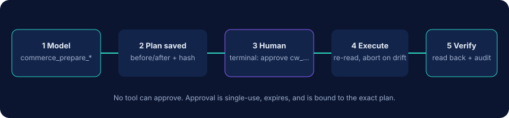

<p align="center"></p>

<p align="center">
  <a href="https://github.com/mysterekkk/commerceweave-mcp/actions/workflows/ci.yml"></a>
  <a href="https://www.npmjs.com/package/commerceweave-mcp"></a>
  <a href="LICENSE"></a>
  
  
  <a href="https://github.com/mysterekkk/commerceweave-mcp/releases"></a>
  <a href="README.md">English</a>
</p>

# CommerceWeave MCP

**Jeden serwer MCP. Trzy platformy sprzedażowe.**

Podłącz agentów AI do **Allegro**, **Base.com** i **WooCommerce** przez jeden bezpieczny, lokalny serwer [MCP](https://modelcontextprotocol.io). Działa na Twoim komputerze przez stdio (opcjonalnie także przez uwierzytelniany HTTP): bez VPS, bez bazy danych, bez konta w usłudze SaaS.

> Status: **v0.1.0. Zweryfikowano na lokalnych serwerach implementujących udokumentowany protokół każdej platformy, jeszcze nie na prawdziwych kontach.** Zobacz [co jest, a czego nie ma w testach](docs/api-compatibility.md#live-testing-status).

## Dlaczego

[Model Context Protocol](https://modelcontextprotocol.io) pozwala klientowi AI (Claude Code, Claude Desktop, Cursor, …) wywoływać narzędzia, które mu udostępnisz. Większość konektorów handlowych obsługuje **jedną** platformę, wystawia jej API wprost i pozwala modelowi od razu zapisywać zmiany.

CommerceWeave różni się czterema rzeczami:

1. **Jeden interfejs.** Te same narzędzia `commerce_*` odpowiadają na pytania z Allegro, Base.com i WooCommerce, na znormalizowanych produktach i zamówieniach z zachowaniem identyfikatorów każdej platformy.
2. **Uczciwe odpowiedzi.** Zaimportowane zamówienia są deduplikowane (zamówienie z Allegro zaimportowane do Base nie liczy się dwa razy), waluty nie są mieszane, przychód nie jest nazywany zyskiem, a każdy wynik mówi, czy jest niekompletny.
3. **Domyślnie tylko odczyt.** Zapisy są *propozycjami* z widokiem przed/po, przypiętymi do dokładnego planu, wykonywanymi dopiero po **Twoim** zatwierdzeniu w terminalu. Model nie może zatwierdzić sam siebie.
4. **Lokalnie.** Uruchamiasz przez `npx` z klienta MCP. Dane dostępowe zostają na Twoim komputerze.

Projekt nie zastępuje oficjalnych integracji. WooCommerce ma własną integrację MCP (developer preview), a kilka serwerów MCP dla samego Allegro lub Base.com obejmuje znacznie więcej metod API niż ten. Zobacz [przegląd rynku](docs/competition.md).

## Co działa

| Platforma | Produkty | Zamówienia | Stany | Ceny | Zapisy (przez zatwierdzone propozycje) |
|---|---|---|---|---|---|
| Allegro | lista / szukanie / szczegóły ofert | lista / szczegóły / zdarzenia | stan oferty | cena kup teraz | stan, cena (asynchroniczne komendy API), status realizacji zamówienia |
| Base.com | produkty katalogu + warianty | lista / szczegóły / dziennik / statusy | per magazyn | per grupa cenowa | stan, cena, status zamówienia |
| WooCommerce | lista / szukanie / szczegóły, warianty, kategorie | lista / szczegóły | produkt i wariant | regularna/promocyjna | stan, cena regularna, status zamówienia |

Narzędzia ujednolicone: lista połączeń, lista/wyszukiwanie produktów, lista/szczegóły zamówień, niskie stany, raport magazynowy, podsumowanie sprzedaży, rozbieżności stanów, sześć narzędzi `prepare_*` (stan, cena, status, notatka, publikacja oferty, szkic produktu), `get_proposal`, `execute_proposal`. Pełna lista: [docs/tools.md](docs/tools.md). Dodatkowo przez zatwierdzane propozycje: publikacja/zakończenie ofert Allegro, nowe produkty (szkic w WooCommerce, produkt katalogu w Base.com). Transporty: stdio (domyślny) i Streamable HTTP z uwierzytelnianiem ([dokumentacja](docs/http.md)).

## Szybki start

Wymagany Node.js 22+.

**1. Wypróbuj na danych syntetycznych (bez kont).**

```bash
claude mcp add commerceweave-demo -e COMMERCEWEAVE_DEMO=true -- npx -y commerceweave-mcp
```

Albo z klona repozytorium: `npm ci && npm run build`, potem `claude mcp add commerceweave-demo -e COMMERCEWEAVE_DEMO=true -- node /bezwzgledna/sciezka/do/commerceweave-mcp/dist/index.js`.

**2. Podłącz swoje sklepy.** Dane dostępowe trzymaj w zmiennych środowiskowych albo w pliku konfiguracyjnym z odwołaniami `env:NAZWA`, nigdy w poleceniu (historia powłoki). Kroki dla każdej platformy: [docs/setup.md](docs/setup.md).

```bash
export WOO_ENABLED=true WOO_STORE_URL=https://twoj-sklep.pl   # + WOO_CONSUMER_KEY / WOO_CONSUMER_SECRET z Twojego menedżera sekretów
npx commerceweave-mcp doctor        # sprawdza konfigurację i wykonuje jedno zapytanie odczytu na połączenie, nie wypisuje sekretów
```

Allegro wymaga jednorazowej autoryzacji: `npx commerceweave-mcp setup allegro`.

**3. Podłącz klienta.** [Claude Code](examples/claude-code/README.md) · [Claude Desktop](examples/claude-desktop/claude_desktop_config.json) · [Cursor](examples/cursor/mcp.json) · dowolny klient MCP ze stdio (`npx -y commerceweave-mcp`).

**4. Zapytaj.**

## Przykłady

- „Pokaż zamówienia z dzisiaj ze wszystkich platform.”
- „Które produkty kończą mi się w magazynie?”
- „Sprawdź, czy produkty mają takie same stany w Base i WooCommerce.”
- „Przygotuj podwyżkę cen o 5% dla tych 10 produktów.”
- „Podsumuj sprzedaż z ostatnich 7 dni bez podwójnego liczenia zaimportowanych zamówień.”

Prawdziwy wynik z serwera demo: [docs/demo-output.md](docs/demo-output.md).

## Bezpieczeństwo



- `COMMERCEWEAVE_MODE=read_only` jest domyślny: żadne narzędzie zapisu nie jest nawet rejestrowane.
- `proposal`: model może przygotować plany (nic nie jest wysyłane do platform).
- `approval_required`: plan wykona się dopiero po uruchomieniu przez Ciebie `commerceweave-mcp approve <id>` w Twoim terminalu i wpisaniu kodu pokazanego przy planie. Zatwierdzenia są jednorazowe, wygasają (domyślnie 15 min), są przypięte do dokładnego planu, a wykonanie przerywa się, jeśli bieżąca wartość się zmieniła.
- Brak zmian w tle i autonomicznych. Brak narzędzia do dowolnych endpointów. Brak masowego usuwania.
- Dane zamówień są maskowane, dopóki wprost o nie nie poprosisz. Teksty sprzedawców i kupujących trafiają do modelu jako oznaczone dane niezaufane.

Model zagrożeń i jego granice: [docs/safety.md](docs/safety.md). Ważne: nie dawaj agentowi nieograniczonej powłoki na tym samym koncie, bo mógłby ominąć zatwierdzanie w terminalu.

Tokeny: tokeny OAuth Allegro są zapisywane w pliku JSON z uprawnieniami `0600` w `~/.commerceweave` (jawnym tekstem), chyba że ustawisz `COMMERCEWEAVE_TOKEN_KEY`, wtedy są szyfrowane AES-256-GCM.

## Dokumentacja

[Konfiguracja platform](docs/setup.md) · [Transport HTTP](docs/http.md) · [Lista narzędzi](docs/tools.md) · [Bezpieczeństwo](docs/safety.md) · [Architektura](docs/architecture.md) · [Zgodność z API i źródła](docs/api-compatibility.md) · [Przegląd rynku](docs/competition.md) · [Rozwiązywanie problemów](docs/troubleshooting.md) · [Rejestr MCP](docs/registry.md) · [Polityka bezpieczeństwa](SECURITY.md) · [Współtworzenie](CONTRIBUTING.md) · [Historia zmian](CHANGELOG.md)

(Dokumentacja szczegółowa jest po angielsku.)

## Ochrona danych osobowych

Zamówienia zawierają dane osobowe, a wyniki narzędzi trafiają do Twojego dostawcy AI. To Ty jesteś administratorem danych: sprawdź regulamin dostawcy i swoje obowiązki wynikające z RODO, zanim włączysz `includePersonalData`. CommerceWeave nie zapisuje danych klientów na dysku, a maskowanie działa w najlepszej możliwej, ale nie absolutnej skali.

## Rozwój

```bash
npm ci
npm run check   # lint, typecheck, testy (prawdziwe sesje MCP po stdio), build
```

## Licencja i autor

MIT. Tworzone i utrzymywane przez LuroWeb.

Allegro, Base.com (BaseLinker) i WooCommerce są znakami towarowymi ich właścicieli. Projekt jest niezależny i nie jest powiązany z żadną z tych firm, przez nie wspierany ani sponsorowany. Nazwy są użyte opisowo.

Potrzebujesz własnej integracji AI-commerce? LuroWeb tworzy dedykowane integracje, workflow i automatyzacje dla e-commerce.
