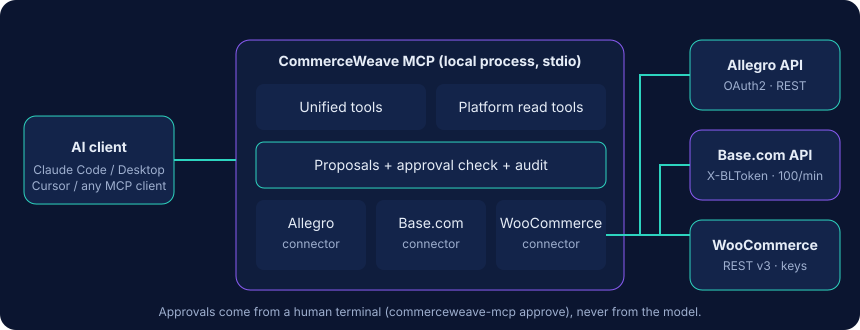

# Architecture



One npm package, one process, stdio transport. No database, no backend, no web UI.

```
src/
  index.ts            CLI entry (serve | check | doctor | setup | approve | ...)
  server/             createServer (tools, prompts, resource), serveStdio wiring
  tools/              unified.ts, platforms.ts, prompts.ts, helpers.ts (define/ok/fail)
  unified/            reads (orders, sales, stock), dedupe, discrepancies, writes (prepare/execute)
  connectors/         allegro/ baselinker/ woocommerce/ + registry + shared Connector interface
  core/               config, http (timeout/retry/limits), rate-limiter, money, time, redact,
                      approvals, token-store, host-guard, errors, models (zod), logging
  demo/               synthetic connectors for COMMERCEWEAVE_DEMO=true
tests/                unit, integration (local protocol servers + real stdio MCP client), security
```

## Design decisions

- **A `Connector` interface** (`listProducts`, `listOrders`, `getOrder`, `readCurrent`, `write`) is all the unified layer knows. Platform specifics (Base catalogs, Woo variations, Allegro async commands) live inside connectors.
- **Models keep source ids** (`source.connectionId/platform/externalId/extra`) so a normalized record can always be traced back and written to precisely.
- **Honest nulls.** Stock `total: null` means "not managed", Base price currency is `null` because the API does not report it. Nothing is invented.
- **Partial failure is a result, not an exception.** Cross-platform tools return `errors[]` and `complete:false` rather than hiding a failing store.
- **Money** is exact decimal arithmetic (bigint, 6-digit scale), half-up rounding to 2 places.
- **Time.** "Today" and "last N days" use IANA time zones (default `Europe/Warsaw`, `COMMERCEWEAVE_TIMEZONE`).
- **HTTP.** Per-request timeout and `AbortSignal`, per-platform rate limiting, exponential backoff with jitter, `Retry-After`. Only reads are retried. A write that times out is `WRITE_OUTCOME_UNKNOWN`.
- **Errors** are typed (`AUTH_FAILED`, `PERMISSION_DENIED`, `RATE_LIMITED`, `TIMEOUT`, `WRITE_OUTCOME_UNKNOWN`, `VALIDATION_FAILED`, `AMBIGUOUS_TARGET`, `STALE_PROPOSAL`, …), returned as MCP `isError` results.
- **stdout is protocol only.** Logs use stderr (masked).

## De-duplication

| Case | Rule | Treatment |
|---|---|---|
| Base order imported from Allegro | Base `external_order_id` equals Allegro checkout-form id | `confirmed`: excluded from sales totals, kept in listings |
| Base order from a shop vs WooCommerce order | same shop order id, currency and total | `potential`: counted, flagged, reported separately |
| Anything else | not compared | counted |

## Stock discrepancy pairing

Explicit `skuMap` groups first, then SKU, then EAN, each only when unique in every involved connection. Duplicated identifiers are returned in `ambiguous`; unmatched items are counted, never force-paired.

## Testing approach

Connector tests run the real connector code over real HTTP against local servers that implement the documented protocol of each platform (headers, pagination, error shapes, async commands). MCP behaviour is tested by spawning the compiled server and driving it with the official MCP client over stdio. These are not live-platform tests; see [api-compatibility.md](api-compatibility.md).
